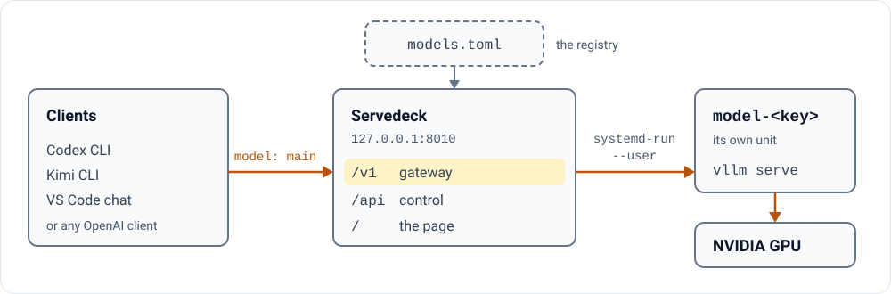

# Servedeck

One OpenAI-style address for all the vLLM models on a Linux GPU machine. Point every coding agent at it once;
switching models is then one command, and no agent changes a setting.

**[Read the docs at servedeck.rlalphalabs.com →](https://servedeck.rlalphalabs.com/)**

```bash
# every agent sends its requests to one address, for the model "main":
curl http://127.0.0.1:8010/v1/chat/completions -H 'Content-Type: application/json' \
  -d '{"model": "main", "messages": [{"role": "user", "content": "Say hi"}]}'
# you choose which model answers as "main":
servedeck switch qwen27b   # stop the running model, wait for the GPU to free, start this one
servedeck status           # what is running now, with its context length, speed and uptime
```

Why not plain systemd units: vLLM exits 0 when its engine dies, so `Restart=on-failure` never fires ([measured
2026-09-18](https://servedeck.rlalphalabs.com/decisions/)); Servedeck restarts the model that should be running.

## Quick start

It is not turnkey: it was built around one workstation, and you need Linux, an NVIDIA GPU, systemd user services,
Python 3.11 or newer and a vLLM build of your own (it does not install vLLM). No Docker, no root.

```bash
git clone https://github.com/pctablet505/servedeck ~/Projects/servedeck
cd ~/Projects/servedeck && uv venv .venv && uv pip install -e .
$EDITOR models.toml                         # your models and your vLLM builds
cp systemd/servedeck.service ~/.config/systemd/user/
systemctl --user daemon-reload && systemctl --user enable --now servedeck
.venv/bin/servedeck doctor                  # check models.toml against the machine
```

The unit expects `~/Projects/servedeck`; to clone elsewhere, edit its `WorkingDirectory` and `ExecStart`.

## How it works

<p>
<picture>
  <source media="(prefers-color-scheme: dark)" srcset="assets/diagram-dark.svg">
  
</picture>
</p>

Each model runs as its own systemd service, so restarting Servedeck never stops one, and a live page at
`http://127.0.0.1:8010` shows each model's speed, memory use and waiting requests. Every model is described once, in
`models.toml`. One real entry, an excerpt with its comments left out:

```toml
[models.lfm2]
id       = "LFM2.5-350M"
repo     = "LiquidAI/LFM2.5-350M"
slot     = "resident"
vram_mib = 4895
port     = 8007
build    = "stock"
ctx      = 32768
```

`id` is the name it answers to; `repo`, the Hugging Face checkpoint it loads; `slot`, `main` (the one agents get,
one at a time) or `resident` (stays loaded beside it); `vram_mib`, a resident's GPU memory in MiB; `port`, where its
own vLLM listens, unseen by clients; `build`, the vLLM build that runs it; `ctx`, its context length in tokens.

## What happens when a model fails to start

A restart on 20 October 2026 asked vLLM for a memory setting it refused, so the new engine quit at start; Servedeck
started it again with the settings of its last good start. All 104 requests sent in the gap got a 503 (service
unavailable) error. From the machine's logs, in seconds from the request:

| When | What happened |
|---|---|
| t+0 s | The restart is asked for, and the running engine begins to stop. |
| t+21 s | The old engine is stopped; the new one starts. |
| t+30 s | The new engine quits: vLLM refuses the memory setting. |
| t+33 s | Servedeck logs `fp4local is wanted but not running; relaunching (attempt 1 of 3)` (`fp4local` is the model's name in `models.toml`) and starts it again. |
| t+164 s | The model is ready. |
| t+174 s | Requests are answered again, on the same address. |

The failed first try cost 12 s. The stop (21 s) and the start (131 s) are part of any restart.

## Leftover memory after a crash

A crashed engine can leave its buffer in RAM until reboot, 40 GiB for one model here; Servedeck frees it, and
deletes nothing it cannot prove is unused.

## Limits

- **Not zero-downtime.** `switch` stops one model before it starts the next; a measured warm start of the
  Flash-Next model took 137 s (2026-09-17).
- **Not an inference engine or a model downloader.** It supervises the vLLM builds you provide.
- **Local only.** It binds `127.0.0.1`, with no login.
- **Alpha.** Version 0.1.0; the docs are the operating record of the machine it was built on, with dates.

## Where next

- [Operations](https://servedeck.rlalphalabs.com/operations/): daily use, what a switch costs, and recovery.
- [Configuration](https://servedeck.rlalphalabs.com/configuration/): every key of `models.toml`.
- [CONTRIBUTING.md](CONTRIBUTING.md): the ground rules, the command and log reference, and how to run the tests.

---

<picture><source media="(prefers-color-scheme: dark)" srcset="assets/mark-dark.svg"></picture>
<sub>**Real numbers, failures left in.** Servedeck is one of the [open-source tools of RL Alpha Labs](https://rlalphalabs.com/tools/), a one-person research lab for Indian stock markets, built by [pctablet505](https://github.com/pctablet505). MIT licensed, see [LICENSE](LICENSE).</sub>
