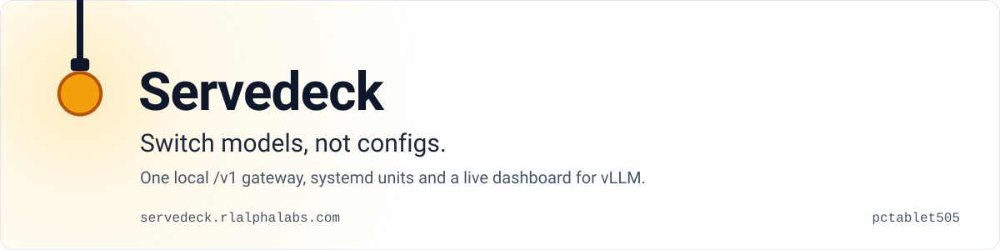
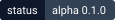

<a href="https://servedeck.rlalphalabs.com/"><picture>
  <source media="(prefers-color-scheme: dark)" srcset="assets/hero-dark.svg">
  
</picture></a>

**Switch models, not configs.** Servedeck runs each vLLM model as its own systemd user unit and gives every
client one local, OpenAI-compatible `/v1` address. Clients ask for the model named `main`, so changing the model
never means editing a config.

**[Read the docs at servedeck.rlalphalabs.com →](https://servedeck.rlalphalabs.com/)**

  

## What you get

One address for every coding agent. Send a request to `main`:

```bash
curl http://127.0.0.1:8010/v1/chat/completions \
  -H 'Content-Type: application/json' \
  -d '{"model": "main", "messages": [{"role": "user", "content": "Say hi"}]}'
```

Switch the model behind it, and the same request reaches the new one:

```bash
servedeck switch flashnext   # stop the main slot, wait for the GPU to free, boot this model
servedeck status             # slot, context, KV-cache use, tok/s, uptime, headroom
```

- **Each model under systemd.** A transient unit `model-<key>` per model, so restarting Servedeck never touches a
  running engine.
- **A live page at `http://127.0.0.1:8010`.** Decode and prefill speed, time to first token, KV-cache use, requests
  held back by a full pool. Each capacity figure says whether it was measured on the running engine or estimated.
- **Memory that comes back.** An engine that crashes leaves its CPU KV-offload buffer (40 GiB for Flash-Next) pinned
  in `/dev/shm` until reboot. Servedeck frees it, and deletes nothing it cannot prove is unused.

## Is it for you?

For one Linux machine with an NVIDIA GPU, running vLLM, where coding agents such as Codex CLI, Kimi CLI and VS Code
chat should share one local endpoint. No Docker, no root.

What it is not:

- **Not zero-downtime.** `switch` stops one model before it boots the next. A measured warm boot of Flash-Next took
  137 s ([Operations](https://servedeck.rlalphalabs.com/operations/)).
- **Not an inference engine or a model downloader.** It supervises the vLLM builds you provide
  ([Builds](https://servedeck.rlalphalabs.com/builds/)).
- **Not multi-host, not authenticated.** It binds `127.0.0.1` only.
- **Not finished.** Version 0.1.0, alpha, built around one workstation. The docs are that machine's operating
  record, with dates.

## Quick start

You need Linux, an NVIDIA GPU, systemd user services, Python 3.11 or newer, and a vLLM build of your own.

```bash
git clone https://github.com/pctablet505/servedeck ~/Projects/servedeck
cd ~/Projects/servedeck
uv venv .venv && uv pip install -e .        # the unit runs .venv/bin/python
$EDITOR models.toml                         # your models and your vLLM builds
cp systemd/servedeck.service ~/.config/systemd/user/
systemctl --user daemon-reload && systemctl --user enable --now servedeck
.venv/bin/servedeck doctor                  # check the registry against the machine
```

The unit expects the checkout at `~/Projects/servedeck`; edit `WorkingDirectory` and `ExecStart` if you clone it
elsewhere. Every key of `models.toml` is in [Configuration](https://servedeck.rlalphalabs.com/configuration/).

## How it works

<p>
<picture>
  <source media="(prefers-color-scheme: dark)" srcset="assets/diagram-dark.svg">
  
</picture>
</p>

One Python process serves the page, the JSON API and the `/v1` gateway on `127.0.0.1:8010`. Every model runs
outside it, in its own transient unit started with `systemd-run --user`. `models.toml` is the only place a model's
identity lives. The design and its trade-offs are in [Architecture](https://servedeck.rlalphalabs.com/architecture/).

## Go deeper

<details>
<summary><b>The five commands</b></summary>

```bash
servedeck status              # what is live: slot, ctx, KV %, run/wait, tok/s, uptime, headroom
servedeck switch flashnext    # put this model in the main slot, evicting whatever is there
servedeck start lfm2          # start (or stop) one model, streaming its boot log until READY
servedeck doctor              # prove the registry against reality before believing anything else
servedeck wire --apply        # rewrite the client configs (no flag = dry-run diff)
```

`start`, `stop`, `switch`, `log` and `adopt` drive the running dashboard over HTTP and fall back to the same
supervisor in-process when it is down, saying which on the first line. `models`, `adopt`, `log` and `smoke` also
exist. None of the verbs take tuning flags: `switch flashnext` launches at the `util` and context that
`models.toml` pins. To launch at other values, use the page's **Configure** panel.

The control plane is a **user** unit: `systemctl --user start servedeck` (`restart` after changing code or
`models.toml`), never `sudo`. Restarting it does not disturb a running model: engines are separate units and this
one sets `KillMode=process`.
</details>

<details>
<summary><b>Logs</b></summary>

```bash
journalctl --user -u servedeck -f          # servedeck itself, including its own logger
journalctl --user -u model-flashnext -f    # one model's engine (unit is model-<key>)
servedeck log flashnext -n 200             # the same journal, through the CLI
```
</details>

<details>
<summary><b>When something is wrong</b></summary>

Run `servedeck doctor`. Besides the registry it checks the host rows that explain most surprises:
`kernel.yama.ptrace_scope` (must be 0, or the KV-offload reaper cannot see a sibling engine and Flash-Next's PLE
handoff fails), desired state naming a model that is not running, weights on disk, leaked
`/dev/shm/vllm_offload_*.mmap` buffers at 40 GiB each, and the GPU power cap. Playbooks:
[Recovery](https://servedeck.rlalphalabs.com/operations/#recovery).
</details>

<details>
<summary><b>Run the tests</b></summary>

`uv venv .venv && uv pip install -e '.[dev]'`, then the everyday run, which touches nothing on the box:

```bash
.venv/bin/python -m pytest -q -n 12 \
  --ignore=tests/test_e2e_real.py --ignore=tests/test_app_e2e.py \
  --ignore=tests/test_control_e2e.py --ignore=tests/test_gateway_e2e.py \
  --ignore=tests/test_cli_control.py
.venv/bin/python -m pytest -q -n 0 tests/test_cli_control.py
```

`test_cli_control.py` runs on its own because it binds a fixed port; under `-n 12` its cases contend with each
other and fail with `httpx.ConnectError` (10 of 16 on a clean tree). Nothing is skipped by splitting it out.

The four excluded files are the gate. Three drive the real `systemd-run` path, safely, under the `sd-test-` unit
namespace, which cannot name a real `model-*` unit; they bind fixed ports, so run them one at a time (`-n 0`).
`test_e2e_real.py` boots real models on the GPU and needs the card to have room. Run the gate on an idle card, not
as part of a normal check. How to contribute: [CONTRIBUTING.md](CONTRIBUTING.md).
</details>

| To | Read |
| --- | --- |
| Use it | [Operations](https://servedeck.rlalphalabs.com/operations/) · [Clients](https://servedeck.rlalphalabs.com/clients/) · [Configuration](https://servedeck.rlalphalabs.com/configuration/) |
| How it is built | [Architecture](https://servedeck.rlalphalabs.com/architecture/) · [Builds](https://servedeck.rlalphalabs.com/builds/) · [Host](https://servedeck.rlalphalabs.com/host/) · [Decisions](https://servedeck.rlalphalabs.com/decisions/) |
| Each model, measured | [Flash-Next](https://servedeck.rlalphalabs.com/models/flashnext/) · [Qwen3.8-27B](https://servedeck.rlalphalabs.com/models/qwen27b/) · [GLM-5.3](https://servedeck.rlalphalabs.com/models/glm53/) · [LFM2.5-350M](https://servedeck.rlalphalabs.com/models/lfm2/) |

---

<picture><source media="(prefers-color-scheme: dark)" srcset="assets/mark-dark.svg"></picture>
<sub>**Real numbers, failures left in.** Servedeck is one of the [open-source tools of RL Alpha Labs](https://rlalphalabs.com/tools/), built by [pctablet505](https://github.com/pctablet505). MIT licensed, see [LICENSE](LICENSE).</sub>
